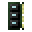
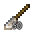
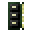
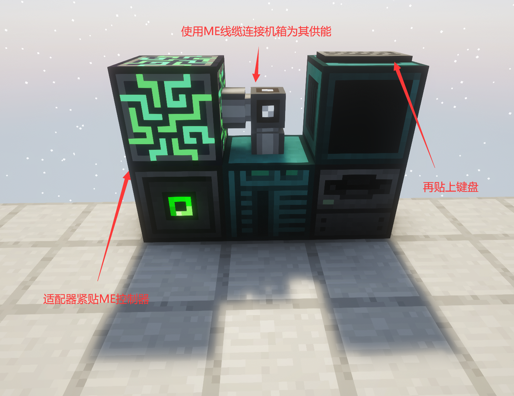
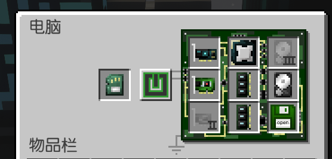
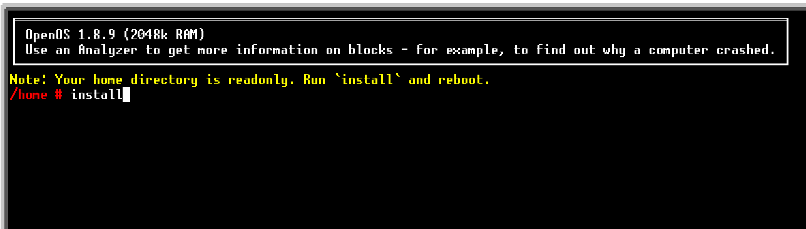

# 接入已有的 WebAE 服务器

这份文档写给**无需自行部署后端**的玩家：你只需要在游戏里放一台 OC 电脑，并接入自己的 AE ，即可在网页上查看和下单。

如果你想自己搭建后端，请看主 [README](../README.md) 和 [部署文档](../deploy/README.md)。

---

## 开始之前：向管理员要这几样东西

- **服务器地址**
- **OC 令牌**
- **网站登录密钥**

**特别注意：**
1. 每套 AE 都需要对应一个 OC 令牌。
2. 请勿和他人共用登录密钥。若需要多人使用同一 AE 网络，请为每位成员各要一个密钥。
3. "我只想使用别人已经接好的 AE 该怎么办？"。只需要登录密钥，请移步至[第八步](#八登录网页)。

---

## 一、OC 硬件需求

| | 部件 | 要求 |
|---|---|---|
|  | 机箱 | T2 或更高，建议T3 |
|  | CPU | T1 即可，保险可以上 T2 或更高 |
|  | 内存 | 取决于你的AE网络大小，T3机箱建议直接上 2 根 T3.5 |
|  | 硬盘 |  |
|  | EEPROM | Lua BIOS |
|    | 显卡、屏幕、键盘 | "能亮就行.jpg" |
|  | **因特网卡** | |
|  | **适配器** | 摆放位置需要紧贴  **ME 控制器**，或者紧贴  **方块形式的 ME 接口** |

另外还要注意：
-  **适配器不能贴在面板形式的 ME 接口上**，它没有网络查询功能，程序会提示找不到 ME 组件。
- **每个合成 CPU 都需要一个**  **合成监控器**， OC 以此读取该 CPU 的合成目标。没有的话，网页上会显示"目标未知"，但其余功能不受影响。
- **电脑所在的区块必须一直加载**。
- 如果想在网页上**指定用哪个合成 CPU**，这个 CPU 需要有名字：你可以使用  石英切割刀为 CPU 命名；当然你也可以用铁砧给一个合成存储器改名，只要不嫌麻烦：），再放进 CPU 结构里。没有名字的 CPU 只能通过"自动选择"使用。（但更推荐使用"自动选择"：OC 无法预览合成计划，如果指定的 CPU 容量不够或者正在忙，这次合成会直接被拒绝，网页上还会显示成"材料不足"，即使网络里有别的 CPU 能完成它。选"自动选择"时，AE 会自己挑一个空闲且容量足够的 CPU。）

如果你能够自行搭建 OC 系统并安装OpenOS，你可以跳过下面的安装教程，直接前往[下载程序](#四下载程序) 

## 二、OC 电脑的搭建

首先需要准备如下材料：
- / 一个T3机箱（T2也可）
-  一个T1中央处理器(CPU)
-  一张T1显卡
- / 两张T3.5内存(如果选用T2机箱则可以用两张T2.5内存先用)
-  一块T1硬盘
-  一张因特网卡
-  EEPROM（Lua BIOS）
-  软盘驱动器
-  OpenOS（Operating System）软盘
-  至少一个T1显示屏（但谁会不喜欢更大的显示屏呢）
-  一个键盘
-  一个适配器

以下为一个可行的结构：



**装机：**
打开机箱，放入你的配件：



如果你的机箱没有放置软盘的地方，可以将软盘放入旁边的 软盘驱动器中。

完成安装后按下机箱中央的开机按键即可启动电脑

## 三、安装 OpenOS

初次启动的电脑上没有操作系统，进入界面后，输入并运行 `install`，按提示将OpenOS装到硬盘上，装好后取出软盘并重启。



## 四、下载程序

在 OC 电脑上运行（把地址换成你的后端服务器地址）：
```
wget https://<服务器地址>/oc/aeweb.lua /home/aeweb.lua
```
看到 `Saved data to /home/aeweb.lua` 就下载好了。

## 五、填写配置

第一次运行时，程序会生成配置文件，然后自动退出：
```
aeweb
```
会提示 `created /home/aeweb.cfg, fill in BASE_URL and TOKEN ...`，这是正常的。接着打开配置文件：
```
edit /home/aeweb.cfg
```
修改这两行：
```lua
BASE_URL = "https://<服务器地址>"
TOKEN = "<你的 OC 令牌>"
```

按 **Ctrl+S** 保存，**Ctrl+W** 退出编辑器。

## 六、运行并确认

```
aeweb
```
正常的话，会依次打印：
```
[  237.2s] ae-web uploader started, target https://<服务器地址>
[  237.2s] memory: 1617 KB free of 2048 KB
[  244.9s] inventory: 3853 entries in 6.2s
```
最后一行代表库存已经成功完成了一次上传。

然后在浏览器里打开服务器地址登录（见第八步），顶部的"状态 x 秒前"在持续刷新，就说明接入成功了。

要停止程序，按 **Ctrl+Alt+C**。

## 七、开机自动运行

如果希望电脑重启后自动运行程序：
```
echo aeweb >> /home/.shrc
```

## 八、登录网页

1. 在浏览器里打开服务器地址，输入你的**登录密钥**；
2. 登录后同设备同浏览器 30 天内不用再输入。

你在每套 AE 里能做什么，取决于你在网络中的身份：

| 身份 | 查看 | 下单 | 撤回订单 | 取消 CPU 上的任务 |
|---|---|---|---|---|
| 只读 | ✓ | | | |
| 成员 | ✓ | ✓ | 只能撤回自己的 | |
| 所有者 | ✓ | ✓ | 所有人的 | ✓ |

网页上各部分的说明，以及怎么下单，见主 README 第四节"你在网页上能看到什么"和第七节"下单合成"。

## 九、更新程序

当程序需要更新时，首先按 **Ctrl+Alt+C** 停掉正在运行的程序，然后在 OC 上运行：
```
wget -f https://<服务器地址>/oc/aeweb.lua /home/aeweb.lua
```
完成下载后重新运行 `aeweb`即可。

---

## 可调参数

一般不用改。需要时在 `aeweb.cfg` 里**去掉对应行前面的 `--`**，再修改数值，然后重新运行程序。

| 参数 | 默认 | 说明 |
|---|---|---|
| `STATUS_INTERVAL` | 5 | 能量和 CPU 的上报间隔（秒） |
| `ITEMS_INTERVAL` | 60 | 完整库存的上报间隔（秒）。库存很大时可以调大 |
| `CHUNK_LINES` | 500 | 上传库存时每个包的行数 |
| `CPU_ITEM_LIMIT` | 300 | 每个 CPU 的"现存 / 正在合成 / 计划合成"列表，各最多上报多少条 |
| `CPU_CALL_BUDGET` | 60 | 每轮上报最多花多少次 AE 调用（约等于 tick 数）刷新忙碌 CPU 的详情 |
| `CPU_FINAL_REFRESH` | 60 | 忙碌 CPU 的合成目标多久重新读取一次（秒） |
| `HTTP_TIMEOUT` | 20 | 单次请求的超时时间（秒） |
| `MAX_ITEM_ID` / `ID_BATCH` | 32767 / 512 | 库存扫描的物品 ID 上限 / 每批读取 ID 数量 |
| `NBT_LIMIT` | 1024 | 上报物品 NBT 的大小上限（字节，压缩后），用来识别改过名的物品；0 为关闭 |

关于 CPU 详情的刷新：同时工作的 CPU 不多时，每轮全部刷新一次（默认 5 秒）；CPU 很多时轮流刷新，比如 64 个 CPU 同时在忙，每个大约 15～20 秒刷新一次。不管哪种情况，状态上报和下单都不会变慢。

---

## 常见问题

### 运行时的报错

| 提示 | 原因和处理 |
|---|---|
| `created /home/aeweb.cfg, fill in BASE_URL and TOKEN ...` | 第一次运行，正常现象。按第五步填写配置 |
| `set BASE_URL and TOKEN in /home/aeweb.cfg first` | 配置还没填，或者还是默认值 |
| `config error: ...` | 配置文件写错了，最常见的是漏了双引号，或者引号是中文的 `“”` |
| `no internet card` | 没有装因特网卡 |
| `no usable ME component ...` | 适配器没有贴着 ME 控制器或方块形式的 ME 接口，或者贴在了面板形式的接口上；也可能是适配器没有用线缆连到电脑 |
| `status upload failed: HTTP 401 ...` | 令牌不对：复制漏了字符，或者管理员已经换过令牌。核对后重新运行程序 |
| `... request failed ...` / `connect timeout` | 连不上服务器：检查地址有没有写错；如果没写错，可能是服务器暂时不可用，请联系管理员 |
| `... HTTP 5xx ...` | 服务器出错了，请把这行提示发给管理员 |
| `skipped item IDs ...` | 某些物品数据太大，OC 内存放不下，这些物品不会出现在网页库存里。可以加内存条；还不行的话，请游戏服务器的管理员参考主 README "已知限制"一节处理 |

想单独测试 OC 能不能连上服务器，运行：
```
wget -f https://<服务器地址>/healthz /tmp/h
cat /tmp/h
```
显示 `{"ok":true}` 就说明网络接通。如果 `wget` 提示网络访问被禁用，说明游戏服务器关掉了 OC 的网络功能，需要游戏服务器的管理员在 OC 的配置里打开。

### 网页上的问题

**状态变黄或变红，"状态 x 分钟前"不再刷新**
OC 程序停了。常见原因：区块被卸载了、电脑没电了、程序出错退出了。到游戏里看一下电脑屏幕上的提示，然后重新运行 `aeweb`。

**订单显示"已过期"**
订单下了以后，5 分钟内没有被 OC 领走就会作废，避免 OC 掉线很久之后突然执行一堆旧订单。说明那段时间 OC 不在线。

**订单显示"状态未知"**
OC 程序重启过，不再跟踪这个订单了。合成任务本身不受影响，请到游戏里确认结果。

**下单后直接失败，提示材料不足**
OC 没有"预览合成计划"的功能，提交后 AE 会直接计算，材料不够就失败，不会像游戏里那样先列出缺什么。

**看不到某个物品，或者物品名是英文**
网页上的中文名和图标来自整合包的物品列表，少数 NEI 里隐藏的物品会显示英文原名或者灰色方块，这是正常现象。

---

## 安全提醒

- **OC 令牌写在 OC 电脑里，因此请妥善保管你的电脑。** 若怀疑令牌泄露，请管理员给你换一个新的，然后按第五步改配置。
- **登录密钥不要发给别人。** 若怀疑泄露，请管理员给你重置，旧密钥和所有已登录的设备会立即失效。
- 请勿删除 OC 上的 `/home/aeweb.handled` 文件，它记录了已经执行过的订单，用来保证同一个订单不会执行两次。

---

<sub>文中的物品图标来自 OpenComputers 和 Applied Energistics 2 的游戏材质，版权归各自作者所有，仅用于说明，不在本项目的 MIT 许可证范围内。</sub>
